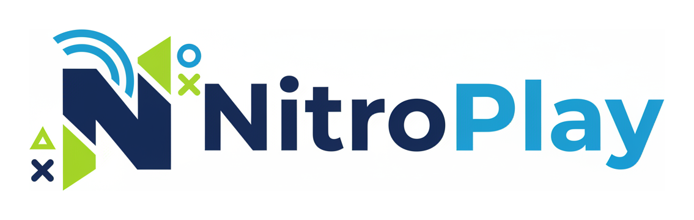

<p align="center">
  
</p>

<h1 align="center">NitroPlay</h1>

<p align="center">Juega a tu PlayStation 4 o PlayStation 5 a distancia, en español y con nitidez ajustable.</p>

<p align="center">
  <a href="COPYING"></a>
  
  <a href="https://github.com/pilahito/NitroPlay/releases"></a>
</p>

## Qué es

NitroPlay es un cliente comunitario de juego remoto para PlayStation 4 y PlayStation 5, basado en [chiaki-ng](https://github.com/chiaki-ng/chiaki-ng). Este repositorio reúne una interfaz en español, un control de nitidez y temas visuales inspirados en PlayStation.


## Novedades frente a chiaki-ng

- **Nitidez ajustable** en Configuración → Vídeo, con los niveles Apagado, Baja, Media y Alta.
- **Interfaz en español.**
- **30 estilos visuales:** 29 temas y el estilo NitroPlay original.
- **Fondos ilustrados** que solo aparecen en el menú de consolas (y en una vista previa al elegir el tema). No cubren la transmisión.

Los temas disponibles son:

- **Consolas:** PS5 clásico, PS4, PlayStation 3, PlayStation 2 y PlayStation 1 - clásico.
- **Juegos:** Marvel's Spider-Man, God of War, Horizon, The Last of Us, Ghost of Tsushima, Astro Bot, Gran Turismo, Ratchet & Clank, Returnal, Uncharted, Bloodborne, Demon's Souls, Death Stranding, Crash Bandicoot, Spyro the Dragon, Metal Gear Solid, Final Fantasy VII, Tekken 3, Shadow of the Colossus, ICO, LittleBigPlanet, inFAMOUS, Killzone y Sackboy: A Big Adventure.
- **Original:** NitroPlay original.

Se eligen en **Configuración → General → Tema**. La elección se guarda para el siguiente inicio.

## Requisitos

- Una PS4 o una PS5 con Remote Play activado.
- Una cuenta de PlayStation Network (PSN).
- Una red compatible. En casa, el PC y la consola deben estar en la misma red local: así se descubre la consola sola y la conexión es la más fluida.
- Para jugar fuera de casa puedes usar la conexión remota por PSN, después de registrar la consola en la red local e iniciar sesión en PSN. Solo funciona por IPv4 (es una limitación de Remote Play en la propia consola). No todos los tipos de NAT permiten el agujero UDP; si falla de forma repetida, hace falta un reenvío de puertos. En PS4, esa conexión remota por PSN solo funciona con la consola principal de la cuenta.

## Instalación y compilación

Todavía no hay paquetes publicados de esta versión. Cuando los haya, aparecerán en [Releases](https://github.com/pilahito/NitroPlay/releases).

### Arch Linux

Con las dependencias de desarrollo de chiaki-ng y las herramientas Linguist de Qt 6 instaladas:

```bash
cmake -S . -B build-es/cmake -G Ninja -DCMAKE_BUILD_TYPE=Release -DCHIAKI_USE_SYSTEM_CURL=ON -DCHIAKI_ENABLE_STEAMDECK_NATIVE=OFF -DCMAKE_POLICY_VERSION_MINIMUM=3.5
cmake --build build-es/cmake --parallel
ctest --test-dir build-es/cmake --output-on-failure
mkdir -p build-es/bin build-es/lib
cp build-es/cmake/gui/chiaki build-es/bin/
cp build-es/cmake/third-party/cpp-steam-tools/libcpp-steam-tools.so build-es/lib/
./scripts/iniciar-es.sh
```

El lanzador `./scripts/iniciar-es.sh` abre la compilación nativa en español. Esta compilación usa la configuración nativa de Chiaki (`~/.config/Chiaki`). La de la aplicación Flatpak se guarda aparte; el lanzador no la migra.

La guía completa está en [README_ES.md](README_ES.md).

### Windows y macOS

Aún no hay instaladores de esta versión para Windows ni macOS. Puedes compilarla desde este repositorio; las indicaciones están en [README_ES.md](README_ES.md).

## Primeros pasos

1. **Activa Remote Play en la consola.**
   - En PS5: Ajustes → Sistema → Remote Play, y enciende Remote Play.
   - En PS4: Ajustes → Ajustes de conexión de Remote Play, y enciende Remote Play. Conviene activar también la PS4 como consola principal (Ajustes → Gestión de cuentas).
   - Si quieres encenderla en reposo, activa en los ajustes de ahorro de energía que siga conectada a internet y que se pueda encender desde la red.
2. **Abre NitroPlay** en la misma red que la consola. La consola debería aparecer sola. Si no aparece, puedes registrarla indicando su dirección IP.
3. **Registra la consola.** Si has iniciado sesión en PSN, puede estar disponible el registro automático. Si no, usa el registro con PIN:
   - En PS5, el código de 8 dígitos está en Ajustes → Sistema → Remote Play → Vincular dispositivo.
   - En PS4, en Ajustes → Remote Play → Añadir dispositivo.
   - En una PS4 o PS5 actual hace falta el *PSN Account-ID* (puedes obtenerlo con los botones «PSN Login» o «Public Lookup»). En una PS4 con firmware anterior a 7.0 se usa el *PSN Online-ID* (el nombre de usuario, respetando mayúsculas y minúsculas).
   - El PIN de Remote Play tiene 8 dígitos. El PIN de la consola (4 dígitos) es opcional y sirve para que la aplicación lo escriba por ti al conectar.
4. **Conecta** pulsando la consola ya registrada.
5. **Ajusta la nitidez** en Configuración → Vídeo → Nitidez (Apagado, Baja, Media o Alta).
6. **Cambia el tema** en Configuración → General → Tema. Verás una vista previa antes de confirmar.

## Preguntas frecuentes

**La imagen va a tirones o hay mucha latencia.**
Usa la red local siempre que puedas: es más estable que la conexión remota. Una conexión por cable o una Wi‑Fi de 5 GHz suele ir mejor que la de 2,4 GHz. En el juego, un modo de rendimiento (y sin HDR si tu pantalla no lo aprovecha) deja más margen a la transmisión.

**No consigo jugar fuera de casa.**
Primero registra la consola en la red local e inicia sesión en PSN (Configuración, pestaña Config, «Iniciar sesión en PSN»). La conexión remota por PSN intenta abrir un túnel UDP; si ves un error repetido de tipo de red no compatible, tendrás que reenviar puertos en el router. Recuerda que Remote Play solo usa IPv4, y que en PS4 únicamente funciona con la consola principal de la cuenta.

**El mando no responde o no se reconocen las funciones del DualSense.**
Los DualSense y DualShock 4 son compatibles. Si el mando está gestionado por Steam, desactiva Steam Input para esta aplicación; si no, la aplicación no puede usarlo del todo (la háptica incluida). Otros mandos se pueden reasignar en Configuración → Controles.

**La consola no aparece.**
Comprueba que está encendida o en reposo (con el encendido desde la red activado) y que el PC está en la misma red. Si sigue sin salir, regístrala a mano con su IP: en PS5 está en Ajustes → Sistema → Software del sistema → Información de la consola; en PS4, en Ajustes → Red → Ver estado de la conexión.

**Al abrir el binario no sale en español.**
El lanzador `./scripts/iniciar-es.sh` fuerza el español. Si abres el binario directamente, la interfaz sigue el idioma del sistema cuando está disponible.

## Créditos y licencia

NitroPlay se publica bajo la [GNU Affero General Public License v3.0](COPYING) (AGPL-3.0).

Es un proyecto comunitario no oficial basado en [chiaki-ng](https://github.com/chiaki-ng/chiaki-ng) y en [Chiaki](https://git.sr.ht/~thestr4ng3r/chiaki), de Florian Märkl y el resto de autores originales. Gracias también a quienes mantienen chiaki-ng, en particular a Street Pea y a quienes aparecen en su documentación.

NitroPlay no está afiliado, patrocinado ni certificado por Sony Interactive Entertainment.
